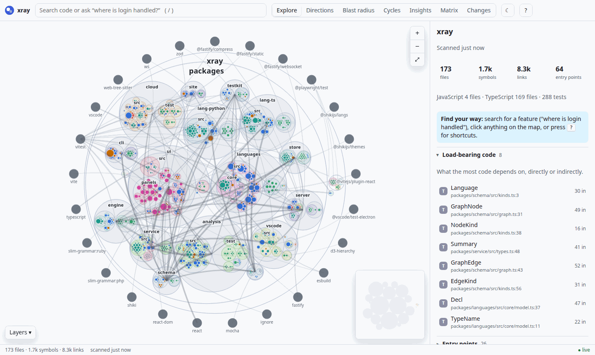
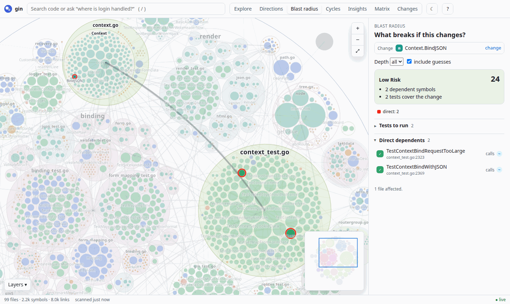
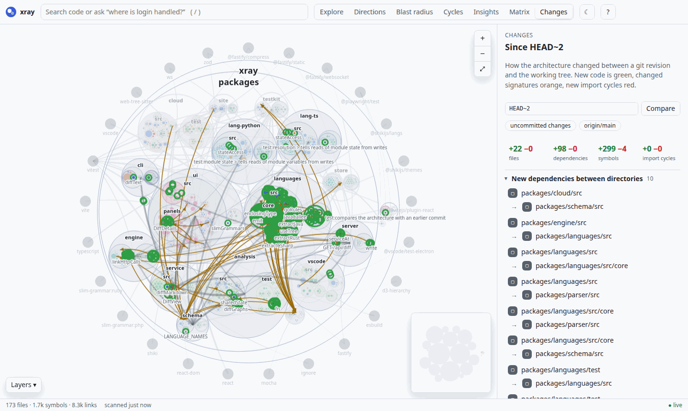
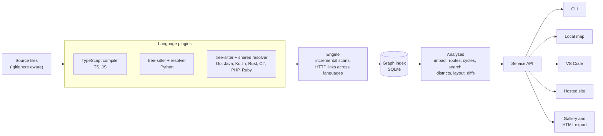

<p align="center">
  
</p>

<h1 align="center">xray</h1>

<p align="center">
  <b>Google Maps for codebases.</b><br>
  Point it at an unfamiliar repository and get a zoomable map of everything in it: every file,
  class and function, and every call, import and inheritance link between them.
</p>

<p align="center">
  <a href="https://github.com/orgalorg7/xray-codebase/actions/workflows/ci.yml"></a>
  <a href="https://www.npmjs.com/package/xray-codebase"></a>
  
  <a href="LICENSE"></a>
</p>

<p align="center">
  <a href="https://orgalorg7.github.io/xray-codebase/"><b>Gallery</b></a> ·
  <a href="#quick-start">Quick start</a> ·
  <a href="#what-it-shows">What it shows</a> ·
  <a href="#languages">Languages</a> ·
  <a href="#how-it-works">How it works</a> ·
  <a href="#development">Contributing</a>
</p>



<p align="center"><sub>xray mapping itself: 173 files, 1.7k symbols, 8.3k links.</sub></p>

## Why

Joining a new codebase usually means days of reading before you can answer simple questions.
xray answers them from a map:

| You want to know | xray shows you |
| --- | --- |
| Where is login handled? | **Search** in plain words: the best matches, their files, routes and tests |
| How does this request reach the database? | **Directions**: the call routes from one function to another |
| What breaks if I change this? | **Blast radius**: everything that depends on it, ring by ring, with the routes and tests it reaches, even in other languages |
| Which files import each other in a loop? | **Cycles**, with the smallest set of imports to cut |
| What did this branch do to the architecture? | **Changes**: new dependencies, new cycles, changed public API |
| Where is the hidden coupling? | **Insights**: hotspot files, shared mutable state, dead code, unused exports |

xray is **static analysis only**. It never runs your code, needs no AI, account or network, and
gives the same answer on every run. Every link says how sure it is: resolved **exactly**,
**inferred** from types or assignments, or **guessed** by name.

## Quick start

**Try it without installing anything:** the [gallery](https://orgalorg7.github.io/xray-codebase/)
has maps of express, zod, fastapi, gin, spring-petclinic, ripgrep, sinatra and more. Anyone can
[request a map](https://github.com/orgalorg7/xray-codebase/issues/new?template=map-request.yml).

**On your own code**, in any repository of the [supported languages](#languages) (Node 24+):

```sh
npx xray-codebase open
```

It scans the repository, starts a local server on `127.0.0.1` and opens the map, then rescans as
you edit. The index lives in `.xray/`; add it to your `.gitignore`.

**In VS Code**, the map opens in a tab (<kbd>Ctrl</kbd>+<kbd>Alt</kbd>+<kbd>M</kbd>), callers and
blast radius appear above every function, and xray shows in hovers and in its own sidebar. See
[packages/vscode](packages/vscode/README.md).

**Hosted**: paste a public GitHub repository and share its map by link, or replace `github.com`
with the site's address in any GitHub URL. To run your own, see
[packages/cloud](packages/cloud/README.md) (one container).

## What it shows

### The map

Code is laid out like places: directories are regions, files are cities, classes and functions
are buildings sized by lines of code. Colors mark **districts**, groups of files that depend on
each other, and **roads** show dependencies between areas at whatever zoom is readable. Every
view lives in the URL, so a link shares exactly what you see. Press <kbd>?</kbd> for shortcuts.

| View | Answers |
| --- | --- |
| **Explore** | What is this? Signature, docs, source, callers and callees, inheritance, git history |
| **Search** | Where does a feature live? Ranked matches with their entry points and tests |
| **Directions** | How does A reach B? The cheapest call routes, step by step |
| **Blast radius** | What breaks if this changes? Dependents by distance, entry points, tests, a risk score |
| **Cycles** | Which files import each other in a loop, and which imports to cut |
| **Insights** | Hotspots, large classes, shared mutable state, dead code, unused exports, districts, churn |
| **Matrix** | The dependency structure matrix: layering at a glance |
| **Changes** | How the architecture changed since a branch, tag or commit |

### Blast radius

Pick a function and xray follows everything that depends on it: callers, subclasses,
overrides, routes that hand requests to it, frontend code that requests those routes, and code
that reads state it writes. You get the entry points it reaches, the tests that cover it and a
risk score.



### Changes over time

`xray diff main` maps `main` in a temporary git worktree (your checkout is untouched) and
compares it with your working tree, or compares two revisions (`xray diff v1.0 v2.0`). It lists
new import cycles, new dependencies between directories, removed or changed public API, routes
and coupling shifts. The **Changes** view shows the same comparison, with new code in green.



### Across languages

Requests with literal URLs (`fetch`, axios, Angular's HttpClient, `requests`, httpx, Go's
`http.Get`, RestTemplate, `HttpClient.GetAsync`, Guzzle, HTTParty and others) are linked to the
routes that serve them, whatever language each side is in. `{id}`, `:id`, `<int:id>`, `[id]`
and `${id}` all match. So a React component's `fetch("/api/users/" + id)` connects to the Go,
Python or Java handler behind it, and a change to that handler shows its frontend callers. Tests
that call routes through test clients (MockMvc, TestClient, Rack::Test) are linked too.

### Module state

For TypeScript, JavaScript, Python and Go, xray records which functions read and which write
module-level variables: assignments, `++`, writes to fields or items, and mutating calls such as
`cache.set` or `items.append`. **Insights** lists *shared mutable state*, variables some code
changes and other code reads, and the blast radius of a function that writes state includes
the code that reads it.

## Languages

| Language | How it resolves | Entry points |
| --- | --- | --- |
| TypeScript, JavaScript | The TypeScript compiler: types, re-exports, path mappings, workspaces, CommonJS, JSX | Express, Fastify, Next.js, commander, yargs, React components, Jest, Vitest, Mocha |
| Python | Its own resolver: packages, `__init__` re-exports, MRO, `self`/`cls`/`super()`, type inference | FastAPI, Flask, Django, click, typer, pytest |
| Go | Packages by directory through `go.mod`, struct embedding, implicit interfaces | net/http, gin, echo, chi, `Test*` |
| Java, Kotlin | Packages, imports and static imports, resolved together since they call each other | Spring, JAX-RS, JUnit, `main` |
| Rust | The crate's module tree, `use` and `pub use`, `impl` blocks and traits, workspaces | actix, rocket, axum, `#[test]` |
| C# | Namespaces and their parents, `using`, static and alias usings | ASP.NET controllers and minimal APIs, xUnit, NUnit, MSTest |
| PHP | Namespaces, `use`, traits, `require` | Laravel, Symfony, PHPUnit |
| Ruby | Global constants, reopened classes, mixins, `require` and Rails autoloading | Rails routes, Sinatra, RSpec, minitest |

Each language is a plugin. The seven tree-sitter languages share one resolver
([packages/languages](packages/languages/src)), so adding another is mostly writing its
extractor; see [Development](#development).

## Command line

```text
xray open [dir]              Scan and open the interactive map
xray scan [dir]              Build or update the index
xray where <query>           Find where a feature lives
xray impact <symbol...>      What may break if these change
xray impact --diff [ref]     ...or if the changes since a git revision land
xray trace <from> <to>       Call routes from one symbol to another
xray diff <ref> [ref]        How the architecture changed since a git revision
xray cycles                  Circular imports with suggested cuts
xray check                   Enforce .xray.json rules (for CI)
xray export --format F       json, html (one offline file), dot, mermaid or graphml
```

Symbols can be given as IDs, `path#Name`, `path:line`, a file path or a plain name. Every command
takes `--json`, and `impact` and `diff` take `--format markdown`.

```sh
xray where "password reset"
xray impact src/billing/invoice.ts#Invoice.total
xray trace handleCheckout chargeCard
xray export --format html -o map.html   # share a map as one file that works offline
```

## In CI

### Architecture rules

`xray check` reads `.xray.json` and exits with 1 when a rule is broken. With `--format github`,
violations become inline annotations; [action.yml](action.yml) packages that as a GitHub Action.

```json
{
  "check": {
    "maxImportCycles": 0,
    "ignoreTypeOnlyCycles": true,
    "layers": [{ "name": "ui is not db", "from": ["src/ui/**"], "disallow": ["src/db/**"] }]
  }
}
```

`xray check --update-baseline` records today's cycles, so only new ones fail. xray checks its own
architecture this way: see [.xray.json](.xray.json).

### Pull request comments

[pr-impact](pr-impact/action.yml) comments on every pull request with the blast radius of its
changes (risk, entry points reached, tests to run, direct dependents) and how it changes the
architecture (new import cycles, new dependencies between directories, API changes). It keeps one
comment per pull request and updates it on every push.

```yaml
on: pull_request
permissions:
  contents: read
  pull-requests: write
jobs:
  impact:
    runs-on: ubuntu-latest
    steps:
      - uses: actions/checkout@v4
        with:
          fetch-depth: 0
      - uses: orgalorg7/xray-codebase/pr-impact@main
        with:
          fail-on-risk: never # or low, medium, high
```

Outside GitHub, `xray impact --diff <base> --format markdown` and
`xray diff <base> --format markdown` produce the same comment.

## How it works



1. **Discover** the files of each language, honoring `.gitignore` and `.xrayignore`.
2. **Extract and resolve** with a plugin per language: declarations, imports, calls (through the
   receiver's declared or inferred type), inheritance, overrides, routes and tests. Results are
   cached per file, so a rescan after a small edit is quick.
3. **Link across languages**: requests to routes, after every plugin has run.
4. **Store** the graph in a SQLite index with stable IDs (`go:store/repo.go#Repo.Find`), so links,
   layouts and diffs survive rescans.
5. **Analyze**: impact rings and risk, k-shortest call routes, Tarjan cycles with suggested cuts,
   feature search (BM25 re-ranked by personalized PageRank), Louvain districts, a circle-packed
   layout, architecture diffs.
6. **Serve** the same API to the CLI, the local map, VS Code, the hosted site and the offline
   HTML export.

**Privacy and safety.** Locally, nothing leaves your machine, and the server only answers
`localhost`. The hosted version fetches one commit shallowly, without hooks, submodules or
symbolic links, maps it in a separate process with memory and time limits, and never runs it.

## Accuracy and speed

The first scan of real projects, measured on a laptop. Later scans reuse the index: with nothing
changed, a rescan takes 10–150 ms.

| Project | Language | Lines | First scan | Calls found | Exact / inferred / guessed |
| --- | --- | ---: | ---: | ---: | --- |
| zod | TypeScript | 103.6k | 13.4 s | 25,496 | 100% / 0% / 0% |
| express | JavaScript | 21.6k | 1.7 s | 1,523 | 26% / 0% / 74% |
| fastapi | Python | 128.4k | 3.5 s | 3,870 | 43% / 56% / 1% |
| flask | Python | 18.4k | 0.5 s | 1,132 | 40% / 28% / 32% |
| gin | Go | 24.7k | 2.2 s | 3,686 | 63% / 32% / 5% |
| spring-petclinic | Java | 4.3k | 0.4 s | 354 | 87% / 11% / 2% |
| kotlinpoet | Kotlin | 40.7k | 2.7 s | 6,809 | 89% / 9% / 2% |
| ripgrep | Rust | 56.5k | 4.0 s | 4,315 | 84% / 9% / 7% |
| Slim | PHP | 16.7k | 1.7 s | 1,272 | 42% / 48% / 10% |
| sinatra | Ruby | 24.3k | 2.2 s | 2,253 | 68% / 8% / 24% |

Dynamic code guesses more. express adds methods to objects at runtime, and Ruby dispatches by
name, so for those, *guessed* links are labeled as such and can be hidden in the blast radius.
xray guesses only when exactly one method in the project has the name, and never for receivers it
knows to be library types.

`pnpm bench` measures the TypeScript, JavaScript and Python rows on pinned commits
([bench/repos.json](bench/repos.json)). Correctness is pinned by golden fixtures: small
repositories with hand-checked expected graphs for every language
([fixtures](fixtures/README.md)).

## Repository layout

| Package | Role |
| --- | --- |
| [`schema`](packages/schema) | The graph model: node and edge kinds, confidence, stable IDs, JSON format |
| [`store`](packages/store) | SQLite graph index with incremental, per-file updates |
| [`parser`](packages/parser) | The language plugin contract and tree-sitter loading |
| [`lang-ts`](packages/lang-ts), [`lang-python`](packages/lang-python) | TypeScript/JavaScript and Python |
| [`languages`](packages/languages) | Go, Java, Kotlin, Rust, C#, PHP and Ruby over one shared resolver |
| [`engine`](packages/engine) | Discovery, incremental scans, watch mode, HTTP links across languages |
| [`analysis`](packages/analysis) | Impact, routes, cycles, search, metrics, districts, layout, diffs (runs in browsers too) |
| [`service`](packages/service) | The API every front end uses: views, checks, exporters, Markdown reports |
| [`server`](packages/server) | Local workspace and HTTP/WebSocket API for `xray open` |
| [`ui`](packages/ui) | The map: a canvas renderer with semantic zoom and a panel per view |
| [`cli`](packages/cli), [`xray-codebase`](packages/xray-codebase) | The `xray` command and its npm bundle |
| [`vscode`](packages/vscode) | The VS Code extension |
| [`cloud`](packages/cloud), [`site`](packages/site) | The hosted version and the GitHub Pages gallery |

## Development

Requires Node 24+ and pnpm.

```sh
pnpm install
pnpm build        # every package, the UI, the npm bundle and the extension
pnpm test         # unit, golden and integration tests (vitest)
pnpm e2e          # the map in a browser (Playwright; PLAYWRIGHT_CHANNEL=chrome uses your Chrome)
pnpm lint         # biome
pnpm typecheck
node packages/cli/dist/bin.js open path/to/repo   # run your build
```

**Adding a language:** write an extractor in [packages/languages/src](packages/languages/src)
(see [go.ts](packages/languages/src/go.ts) for a compact example) that turns a tree-sitter tree
into declarations, imports, calls and routes, and the scoping rules that say what a name can refer
to. Then add a fixture with its expected graph under [fixtures](fixtures); the golden tests score
every edge against it.

## Roadmap

Built so far:
- The engine and its analyses.
- The command line and the local map.
- The VS Code extension.
- The hosted version and the gallery.
- Pull request comments.
- Ten languages.
- HTTP links between languages.
- Architecture diffs.
- Module state.

Next:
- Private repositories on the hosted version (a GitHub App).
- gRPC, GraphQL and message queues as links between services.
- Module state for every language.
- More languages: Swift, C and C++, Scala.

## License

[MIT](LICENSE)
